# The games

Ports of the Amiga games to the 3DO through the sdk/amiga compatibility
layer, and three Unity games rebuilt for the 3DO's cel engine (Planet Chomp,
Spectral Keep and Rolling Steel).
Every game is its own disc (`./3do build <game>`), and the arcade
disc (`./3do build arcade`) bundles all of them behind a menu.
Screenshots are from the automated tests; regenerate this page with
`docs/tools/capture_games.py`.

## The arcade

Up/Down choose, Left/Right page, A plays. In a game, X goes back to the
menu. The bar to the right of the list shows where you are.

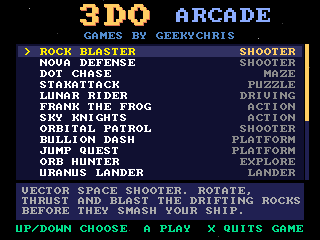 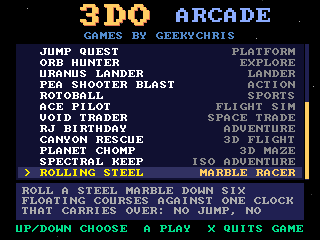

## Speed on the 3DO

Every game keeps its Amiga speed: logic runs at 50 steps per second
(the PAL frame rate), and the 3D games that draw fewer frames catch
up on logic steps (`gfx_steps()`) rather than slowing down.
Measured in the emulator by `./3do selftest`. The amiga3d games
(Block Breaker 3D onwards) step their logic 25 times a second, as on the
Amiga; their frame rates come from `./3do test`.

| Game | logic steps/s | frames drawn/s |
|---|---|---|
| [Rock Blaster](#rock-blaster) | 50 | 50 |
| [Nova Defense](#nova-defense) | 50 | 50 |
| [Dot Chase](#dot-chase) | 50 | 50 |
| [StakAttack](#stakattack) | 50 | 50 |
| [Lunar Rider](#lunar-rider) | 50 | 50 |
| [Frank the Frog](#frank-the-frog) | 50 | 42 |
| [Sky Knights](#sky-knights) | 50 | 50 |
| [Orbital Patrol](#orbital-patrol) | 50 | 44 |
| [Bullion Dash](#bullion-dash) | 50 | 50 |
| [Jump Quest](#jump-quest) | 50 | 50 |
| [Orb Hunter](#orb-hunter) | 49 | 49 |
| [Uranus Lander](#uranus-lander) | 50 | 50 |
| [Pea Shooter Blast](#pea-shooter-blast) | 50 | 50 |
| [Rotoball](#rotoball) | 49 | 29 |
| [Ace Pilot](#ace-pilot) | 50 | 26 |
| [Void Trader](#void-trader) | 50 | 24 |
| [RJ Birthday](#rj-birthday) | 50 | 50 |
| [Canyon Rescue](#canyon-rescue) | 50 | 9 |
| [Planet Chomp](#planet-chomp) | 49 | 14 |
| [Spectral Keep](#spectral-keep) | 50 | 50 |
| [Rolling Steel](#rolling-steel) | 50 | 18 |
| [Emberkeep](#emberkeep) | 50 | 50 |
| [Warden Keep](#warden-keep) | 50 | 50 |
| [Miner Meteor](#miner-meteor) | 50 | 50 |
| [Block Breaker 3D](#block-breaker-3d) | 25 | 15 |
| [Marble Tilt](#marble-tilt) | 25 | 11 |
| [Harbour Crane](#harbour-crane) | 25 | 14 |
| [Tank Duel](#tank-duel) | 25 | 14 |
| [Orbit Docking](#orbit-docking) | 25 | 13 |
| [Stack Tower](#stack-tower) | 25 | 5.5 |
| [Ridge Runner](#ridge-runner) | 25 | 9 |
| [Drone Courier](#drone-courier) | 25 | 17 |
| [Canyon Rail](#canyon-rail) | 25 | 15 |
| [Lander 3D](#lander-3d) | 25 | 3.8 |
| [Boing Pinball](#boing-pinball) | 25 | 25 |
| [ScAIry Fun](#scairy-fun) | 25 | 4.5 |

## Games

### Rock Blaster

Vector space shooter. Rotate, thrust and blast the drifting rocks before they smash your ship. LEFT/RIGHT rotate, UP or B thrust, A fire.

Shooter · `projects/rock_blaster` · from the Amiga version

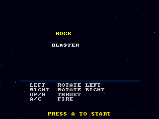 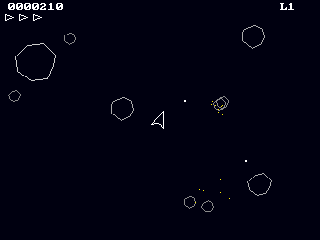

### Nova Defense

Fixed-screen alien shooter. Hold back the descending swarm from behind your shields and pick off the saucer. LEFT/RIGHT move, A fire.

Shooter · `projects/nova_defense` · from the Amiga version

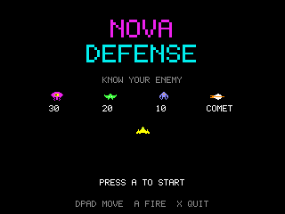 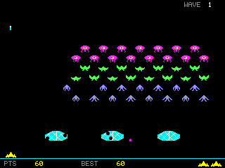

### Dot Chase

A ladybug in a hedge maze. Gather every seed while four spiders hunt you; eat a flower to scare them and catch them for points. D-pad steers, A starts.

Maze · `projects/dot_chase` · from the Amiga version

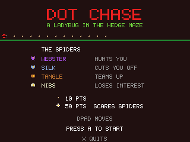 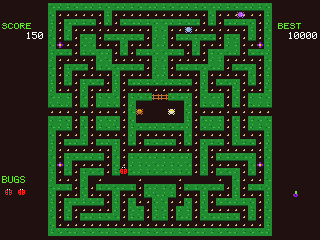

### StakAttack

Falling-block puzzle with tracker music. Fit the pieces together and clear lines before the stack reaches the top. LEFT/RIGHT move, A rotate, B drop, DOWN soft drop, P pause.

Puzzle · `projects/stakattack` · from the Amiga version

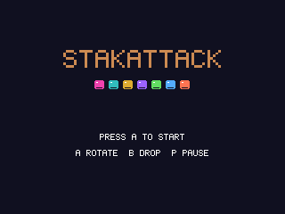 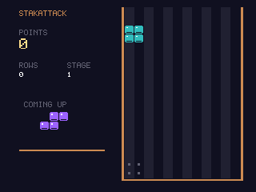

### Lunar Rider

Moon buggy ride. Jump the craters and rocks while shooting UFOs and meteors on the way to each checkpoint. LEFT/RIGHT speed, UP or B jump, A shoot.

Driving · `projects/lunar_rider` · from the Amiga version

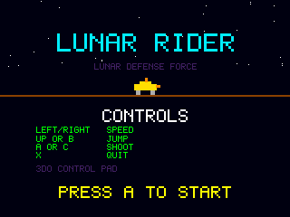 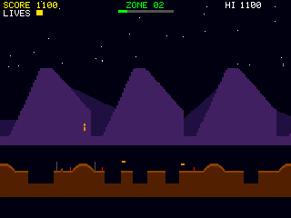

### Frank the Frog

Help Frank cross the busy road and the river, with generated music. Hop across the traffic and ride the river to reach every home. D-pad hops, A starts.

Action · `projects/frank_the_frog` · from the Amiga version

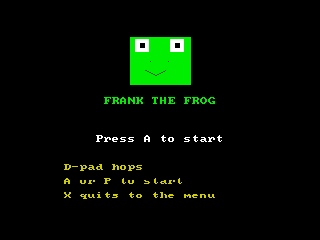 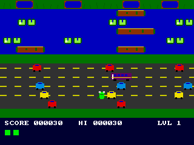

### Sky Knights

Jousting on flying mounts for one or two players. Land on enemies from above and collect the eggs. D-pad steers, A flaps. A starts one player, C two (second pad).

Action · `projects/sky_knights` · from the Amiga version

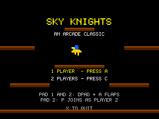 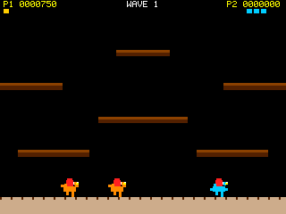

### Orbital Patrol

Side-scrolling planet defence with tracker music. Fly over the planet, shoot the invaders and protect the humans. D-pad flies, A fire, B smart bomb, C hyperspace.

Shooter · `projects/orbital_patrol` · from the Amiga version

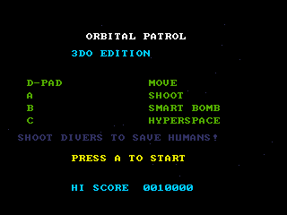 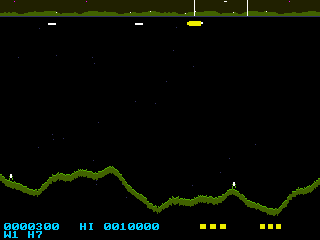

### Bullion Dash

Puzzle platformer with a level editor. Collect the gold, dig traps for the guards, then climb out. A fire, B/C dig left/right. C on the title opens the editor: A put, B tile, L save, R load, P test.

Platform · `projects/bullion_dash` · from the Amiga version

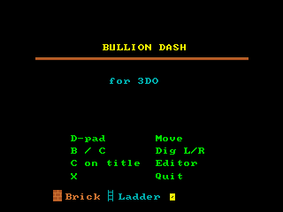 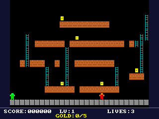

### Jump Quest

Side-scrolling platformer for one or two players taking turns. Pick RJ or Dale, jump on the enemies and reach the end of three levels. D-pad moves, A jumps.

Platform · `projects/jump_quest` · from the Amiga version

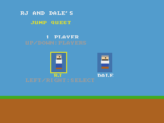 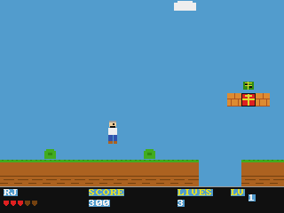

### Orb Hunter

Cavern exploration. Search the caverns room by room, collect power-ups to reach new areas. LEFT/RIGHT move, UP or B jump, DOWN rolls, A fires (bombs when rolled), UP + A fires a missile.

Explore · `projects/orb_hunter` · from the Amiga version

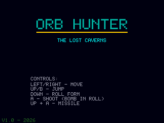 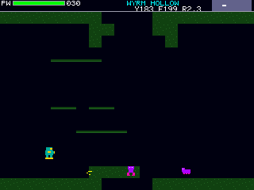

### Uranus Lander

Land on the rings of Uranus, with tracker music. Rotate, thrust gently and touch down on the pads before the fuel runs out. LEFT/RIGHT rotate, A thrust.

Lander · `projects/uranus_lander` · from the Amiga version

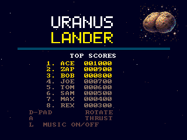 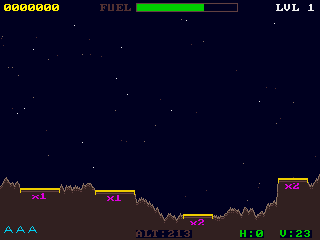

### Pea Shooter Blast

Side-scrolling tank action. Drive, jump and blast through the enemy lines to the end of each level. D-pad drives, UP or B jumps, A fires.

Action · `projects/pea_shooter_blast` · from the Amiga version

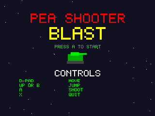 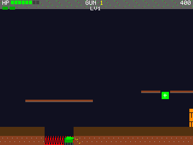

### Rotoball

Split-screen futuristic ball sport against the computer. Steer your skimmer, grab the orb and carry it over the goal line. UP or A forward, DOWN or B reverse, LEFT/RIGHT strafe.

Sports · `projects/rotoball` · from the Amiga version

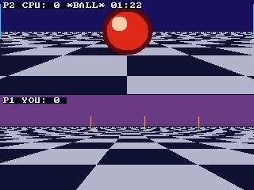

### Ace Pilot

3D wireframe dogfighting over an airfield to the Blue Danube, one player or two in split screen. D-pad flies, A fires, L/R throttle. L or R on the title picks 1 or 2 players.

Flight sim · `projects/ace_pilot` · from the Amiga version

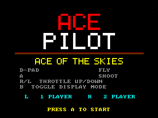 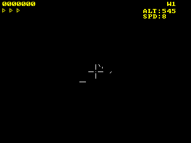

### Void Trader

3D space trading and combat with generated music. Fly, fight the pirates, dock at the station and trade. D-pad pitch/yaw, L/R roll, B/C thrust, A fire, P dock. Docked: UP/DOWN pick, B buy, C sell, P launch.

Space trade · `projects/void_trader` · from the Amiga version

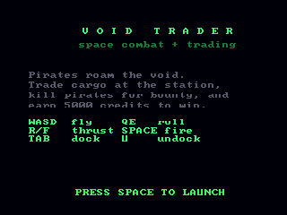 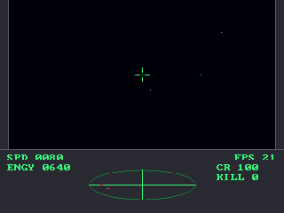

### RJ Birthday

Birthday party adventure with tracker music. Run around the party rooms, greet the guests, find the cake. D-pad moves, A acts, B help, C guest list, X back. Names: A adds a letter, UP/DOWN change it, B deletes, P confirms.

Adventure · `projects/rj_birthday` · from the Amiga version

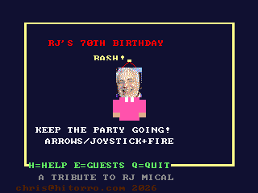 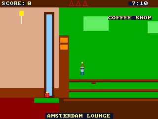

### Canyon Rescue

Fly a fractal planet's valleys and rescue downed pilots - but some are Mimics in disguise. Up/Down thrust and brake, Left/Right turn, L/R climb and dive, A fires, B lands, P starts.

3D flight · `projects/canyon_rescue` · from the Amiga version

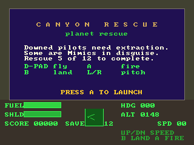 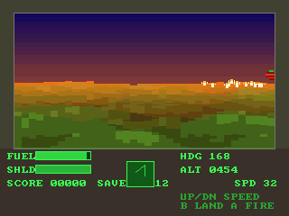

### Planet Chomp

A maze chase on a tiny planet: the maze wraps all the way round a sphere. Eat every crumb, dodge the four spooks, grab a golden key to eat them. D-pad steers (relative to the screen), L/R spin the view, C whole planet, P pause.

3D maze · `projects/planet_chomp` · from the Unity version

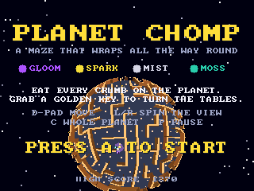 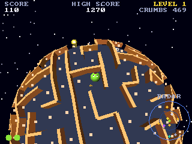

### Spectral Keep

An isometric flip-screen adventure through three keeps: find the relics and carry them to the throne. Keys open gates; guards, hounds, ghosts and bouncers are deadly. D-pad walks (relative to the screen), A or B jumps, P pause. On the title: C grid controls, B music, L+R a tour of every room.

Iso adventure · `projects/spectral_keep` · from the Unity version

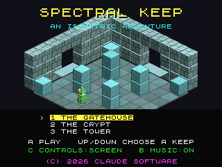 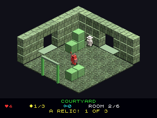

### Rolling Steel

Roll a steel marble down six floating courses against one clock that carries over: no jump, no brakes, just momentum. Ice slides, sand bites, acid dissolves; sweepers, crushers, fans, chasers and blobs. D-pad pushes (relative to the view), L/R turn the view, A/B zoom, C+up/down tilt. Two players on two pads.

Marble racer · `projects/rolling_steel` · from the Unity version

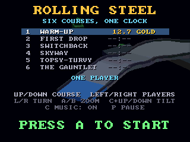 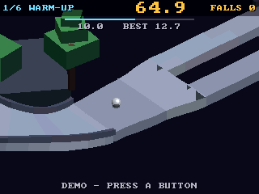

### Emberkeep

Top-down cavern explorer by lantern light: collect the runes to open the exit portal and keep the lamp burning with oil flasks. D-pad walks, A or P starts. C on the title plays a demo of chamber 1.

Explore · `projects/emberkeep` · from the Amiga version

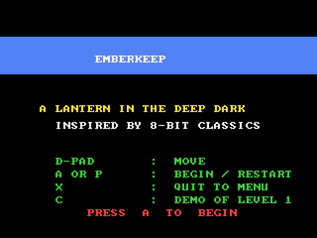 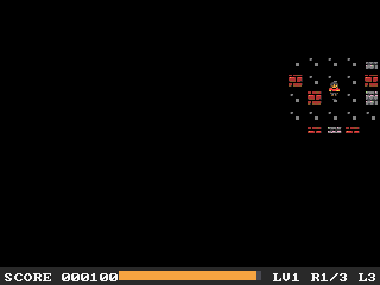

### Warden Keep

Isometric room adventure: push the barrels and collect the three jewels. D-pad steps one tile (hold to repeat), A or P starts.

Iso adventure · `projects/warden_keep` · from the Amiga version

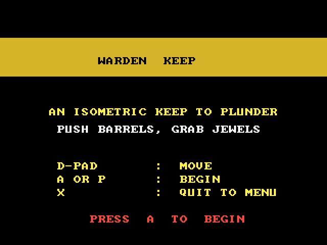 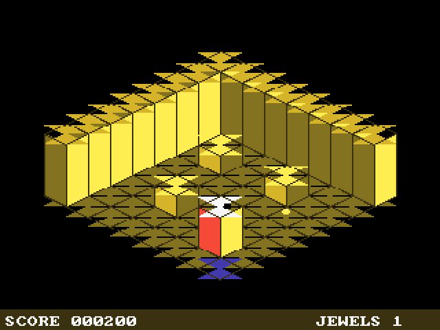

### Miner Meteor

Single-screen platformer: collect the keys and reach the exit before the air runs out, past spikes, conveyors, collapsing floors and guardians. LEFT/RIGHT walk, A, B or UP jumps, A or P starts. C on the title plays a demo of cavern 1.

Platform · `projects/miner_meteor` · from the Amiga version

 

### Block Breaker 3D

Breakout down a tunnel: a paddle across the near opening, bricks 3 deep at the far end. D-pad moves, A serves, B autopilot, C help, P pause, L title.

Breakout · `projects/block_breaker_3d` · from the Amiga version (amiga3d engine)

 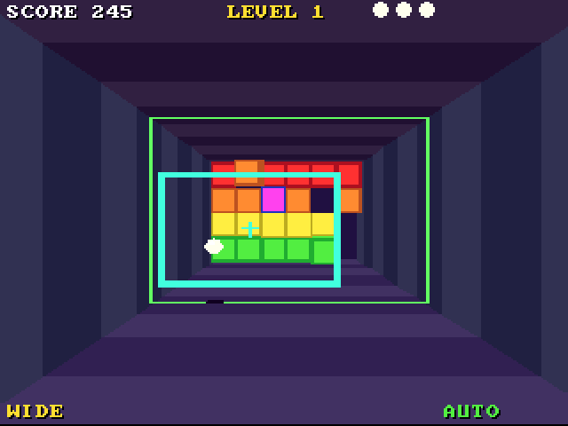

### Marble Tilt

Tilt a maze board to roll a marble to the exit against the clock: holes, gates, bumpers, sand. D-pad tilts, A starts, B autopilot, C help, P pause, L title.

Puzzle · `projects/marble_tilt` · from the Amiga version (amiga3d engine)

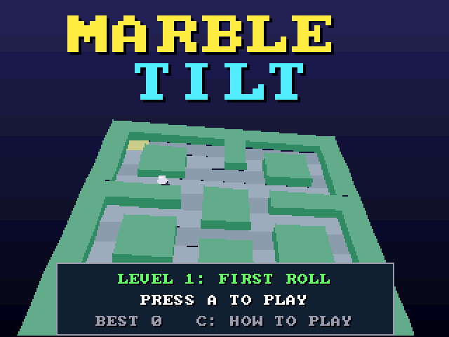 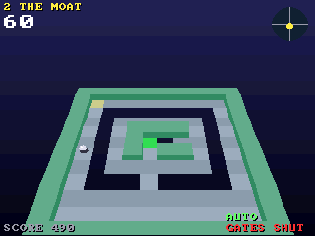

### Harbour Crane

Load a rolling ship with a swinging gantry crane: land containers square, keep her level, beat the clock. D-pad trolley/winch, A grab/let go, B autopilot, C help, P pause, L title.

Simulation · `projects/harbour_crane` · from the Amiga version (amiga3d engine)

 

### Tank Duel

A tank fight in a walled arena, from the turret, with a radar. D-pad drives and turns, A fires, B autopilot, C help, P pause, L title.

3d action · `projects/tank_duel` · from the Amiga version (amiga3d engine)

 

### Orbit Docking

Dock with a spinning space station: line up, match the spin, close slowly. D-pad moves across, A in, C out, L/R roll, B autopilot, P pause.

Space sim · `projects/orbit_docking` · from the Amiga version (amiga3d engine)

 

### Stack Tower

Falling blocks round a tower: rings clear only when the back is full too. D-pad turns/rotates/drops, A hard drop, B rotate back, C hold, L ghost, R help, P pause.

Puzzle · `projects/stack_tower` · from the Amiga version (amiga3d engine)

 

### Ridge Runner

Hover-bike racing over generated hills: gates, jumps, boost, three rivals. D-pad steers/throttles/brakes, A boost, B autopilot, C help, P pause, L title.

Racing · `projects/ridge_runner` · from the Amiga version (amiga3d engine)

 

### Drone Courier

Deliver parcels across a city of towers by drone: wind, battery, fragile loads. D-pad flies and turns, A climbs, B autopilot, C help, P pause, L title.

Flight · `projects/drone_courier` · from the Amiga version (amiga3d engine)

 

### Canyon Rail

A rail shooter down a winding canyon: turrets, drones, a guardian at the end. D-pad moves the sight, A fires, B autopilot, C help, P pause, L title.

Shooter · `projects/canyon_rail` · from the Amiga version (amiga3d engine)

 

### Lander 3D

Land on generated terrain: the Moon, Mars, an asteroid. D-pad pitches and rolls, A full thrust, B/C steady throttle, R help, P pause, L title. (Slow on the 3DO: 4-5 fps.)

3d flight · `projects/lander_3d` · from the Amiga version (amiga3d engine)

 

### Boing Pinball

Three pinball tables with the Boing ball: ramps, spinners, missions, multiball. L/R flippers, A plunger, D-pad up nudges, B bot, C help, P pause.

Pinball · `projects/boing_pinball` · from the Amiga version (amiga3d engine)

 

### ScAIry Fun

The self-driving car game: know when not to trust it. A takes over / hands back, D-pad steers and brakes, B view, C help, P pause, L title. (Slow on the 3DO: 4-5 fps.)

Driving · `projects/scairy_fun` · from the Amiga version (amiga3d engine)

 
