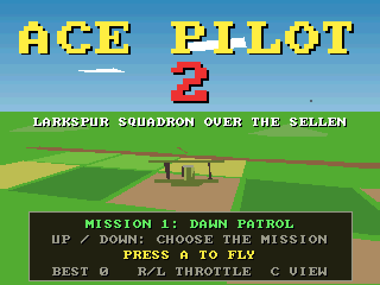
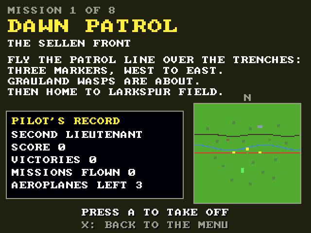
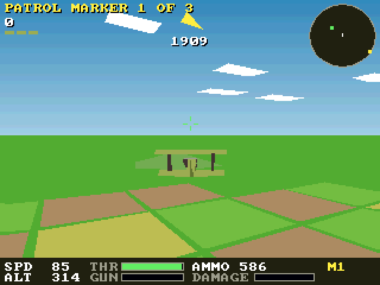
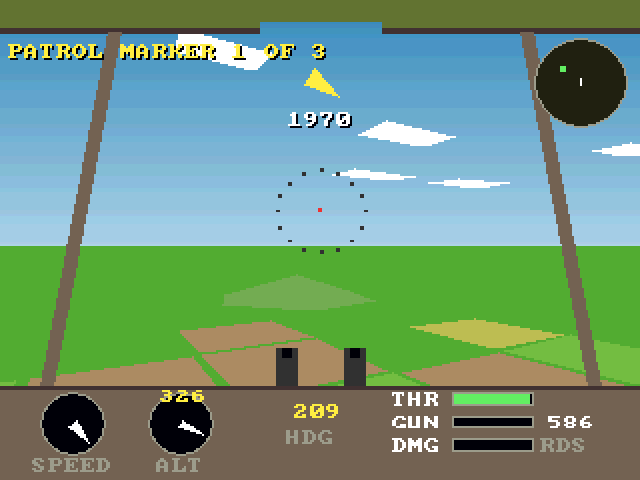
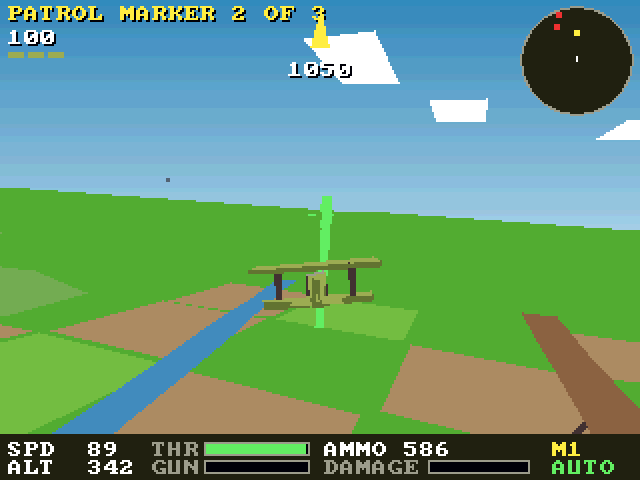

# Ace Pilot 2 (3DO)

The [amiga_mcp](https://github.com/geekychris/amiga_mcp) game
`examples/ace_pilot2` (classic Amiga and AmigaOS 4) on the 3DO, on the
[`amiga3d`](../../sdk/amiga3d/README.md) engine's 3DO platform layer.
A biplane war in 3D: a Swallow scout of Larkspur Squadron against the
Grauland air service over the trenches and the river Sellen, eight missions
(patrols, balloons, an escort, a train, bombers, supply dumps, an aerodrome
raid and the Grey Falcon), flown from behind or from the cockpit. An
autopilot flies on its own, and behind the title.

## Playing

| Pad | |
|---|---|
| D-pad left/right | bank |
| D-pad up/down | nose down / up; on the title, the mission |
| A | the guns; start |
| L / R | throttle down / up |
| C | chase / cockpit view |
| B | the autopilot on/off |
| P | start (title), pause (play) |
| X | back to the arcade menu |

The Amiga's help pages (H), inverted pitch (I) and Esc to the title have no
button left on the pad; the title shows the throttle and view buttons
instead, and a finished campaign goes back to the title by itself.

## Speed

About **9 fps** in play under the emulator (the ARM60 at 12.5 MHz), chase or
cockpit view. The flight keeps its real speed (25 steps a second, stepped by
the clock): playable, if not smooth.

## The port

The game's sources (`src/`: `ace.h`, `ap.h`, `ap_core.c`, `game.c`,
`render.c`; its tests in `src/tests/`) are the Amiga ones, changed only
where Norcroft C89 or the 3DO needs it:

- `ap_state_hash`: a run-time array initialiser rewritten as assignments (`sdk/amiga3d/tools/c89init.py`)
- `ap_core.c`: one declaration after a statement, moved up
- `render.c`: the model's back-face test uses `a3_dot3_nonneg` (no 64-bit
  integers on Norcroft) under `#ifdef AMIGA3DO`
- On-screen key names (the controls page, "PRESS FIRE"): a 3DO line naming the pad's buttons under `#ifdef AMIGA3DO` (`sdk/amiga3d/tools/padtext.py`)

The game's own banking camera, roll-aware model drawing and precise chase
camera (`cam_place` / `cam_for`) work on the 3DO unchanged.

`src/pad_3do.c` maps the pad onto the game's keys and joystick and gives the
status line the test reads.

`./3do test ace_pilot2` runs the game's own tests on the 3DO (65, among them
the 20,000-tick autopilot campaign whose state hash must match
`tests/vectors.h`, 0x2B867448), then the game itself: title, briefing,
take-off, L/R throttle, banking and pitch, A firing, C the cockpit view, the
autopilot flying the mission, the frame rate, X to the menu.
