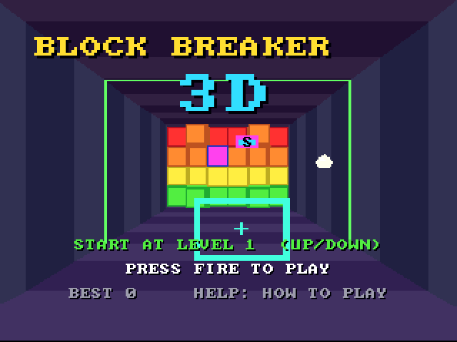
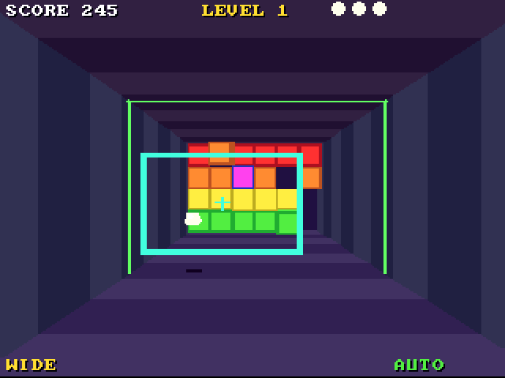

# Block Breaker 3D (3DO)

The [amiga_mcp](https://github.com/geekychris/amiga_mcp) game
`examples/block_breaker_3d` (classic Amiga and AmigaOS 4) on the 3DO,
running on the [`amiga3d`](../../sdk/amiga3d/README.md) engine's 3DO
platform layer. Breakout played down a tunnel: the paddle is a frame across
the tunnel's near opening, the bricks are 6 across, 4 high and 3 deep at
the far end. Eight levels, capsules (wide, slow, extra life, plough), an
autopilot that also plays the demo behind the title.

## Playing

| Pad | |
|---|---|
| D-pad | move the paddle; on the title up/down picks the start level |
| A | serve the ball; start the game |
| P | start (title), pause (play) |
| B | the autopilot on/off |
| C | the help pages |
| L | back to the title |
| X | back to the arcade menu |

## Speed

About **14-15 fps** in play under the emulator (the ARM60 at 12.5 MHz),
9 on the title (more text). The game's logic keeps its real speed (25 steps
a second, stepped by the clock), so it is fully playable, just less smooth
than the Amiga's 25 fps.

## The port

The game's sources are the Amiga ones, unchanged except where Norcroft C89
needs it (one run-time array initialiser in `bb_state_hash`, rewritten by
`sdk/amiga3d/tools/c89init.py`):

| File | |
|---|---|
| `src/bb_core.c`, `src/bb.h` | the simulation (no platform code) |
| `src/game.c`, `src/render.c`, `src/breaker.h` | the shell and the drawing |
| `src/tests/test_cases.c`, `src/tests/vectors.h` | the game's tests and the long autopilot game's state hash |
| `src/pad_3do.c` | the pad mapping (Amiga raw keys / joystick bits) and the status line the test reads |

On-screen key names (help pages, "PRESS FIRE") have a 3DO line naming the pad's
buttons under `#ifdef AMIGA3DO` (`sdk/amiga3d/tools/padtext.py`).

`./3do test block_breaker_3d` runs the game's own tests on the 3DO (42,
including the 20000-tick autopilot game whose hash must match
`tests/vectors.h` - the 64-bit fixed point is done in 32-bit pieces there),
then the game: title, a start, the paddle on the D-pad, a serve, the
autopilot, the frame rate, X to the menu.
