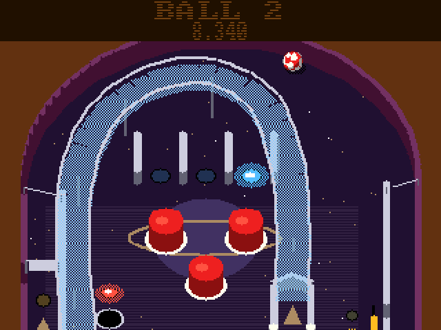

# Boing Pinball (3DO)

The [amiga_mcp](https://github.com/geekychris/amiga_mcp) game
`examples/boing_pinball` (classic Amiga and AmigaOS 4) on the 3DO, on the
[`amiga3d`](../../sdk/amiga3d/README.md) engine's 3DO platform layer.
Three pinball tables (Comet Tour, Deep Sea, Foundry) with the Boing ball: ramps, spinners, drop-target banks, a saucer, missions, multiball. Each table is drawn once into a tall picture and scrolled; the ball, flippers and lamps go on top. The browser game's physics, checked against it. Its own music (`takeme/boing_pinball/boing_pinball.mod`, "Silver Ball Shuffle", from the amiga_mcp modgen). The bot plays the table behind the title.

## Playing

| Pad | |
|---|---|
| L / R | the left / right flipper (D-pad left/right too); on the title, the table |
| A, D-pad down | the plunger: hold to pull, let go; start |
| D-pad up | nudge |
| B | the bot plays on/off |
| C | the help pages |
| P | pause; F1-start on the title |
| X | back to the arcade menu |

## Speed

The full **25 fps** under the emulator (the ARM60 at 12.5 MHz): the table is a picture copied a window at a time, so there is little to draw. Plays as on the Amiga.

## The port

The game's sources (`src/`: `game.c`, `pb.h`, `pb_core.c`, `pb_tables.c`, `pinball.h`, `render.c`; its tests in
`src/tests/`) are the Amiga ones, changed only where Norcroft C89 or the
3DO needs it:

- `tests/test_cases.c`: the 64-bit mask of events seen kept in 32 bits on the 3DO (only its bits 48-55 are ever compared)
- `render.c`: its `Item` type renamed (`#define Item pb_Item`: the 3DO's headers have an `Item`)
- `game.c`: B toggles the bot in play on the 3DO (on the Amiga it is a bridge hook), and one `sscanf` in a bridge hook left out (the 3DO's libc has none); `tests/preview.c` (a host tool) not built
- On-screen key names (help pages, "PRESS FIRE"): a 3DO line naming the pad's buttons under `#ifdef AMIGA3DO` (`sdk/amiga3d/tools/padtext.py`)

`src/pad_3do.c` maps the pad onto the game's keys and joystick and gives the
status line the test reads.

`./3do test boing_pinball` runs the game's own tests on the 3DO (81, among them
the browser original's vectors in `tests/vectors.h`: collisions, and a short
flight that must end where the browser's does),
then the game itself: title (the bot), a start, the plunger, both flippers, the bot playing and scoring, the frame rate, X to the menu.
