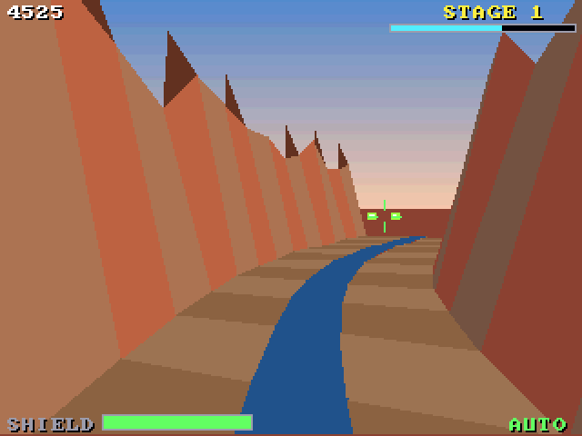

# Canyon Rail (3DO)

The [amiga_mcp](https://github.com/geekychris/amiga_mcp) game
`examples/canyon_rail` (classic Amiga and AmigaOS 4) on the 3DO, on the
[`amiga3d`](../../sdk/amiga3d/README.md) engine's 3DO platform layer.
A rail shooter down a winding canyon: the ride is on rails, you move the sight and fire at turrets on the walls and swooping drones, with a guardian at the end of each stage. An autopilot shoots on its own, and behind the title. (Hits are found with the engine's own projection.)

## Playing

| Pad | |
|---|---|
| D-pad | move the sight; on the title up/down picks the stage |
| A | fire (held: five shots a second); start |
| P | start (title), pause (play) |
| B | the autopilot on/off |
| C | the help pages |
| L | back to the title |
| X | back to the arcade menu |

## Speed

About **15 fps** under the emulator (the ARM60 at 12.5 MHz). The ride keeps its real speed (25 steps a second, stepped by the clock): plays well. The sky's copper gradient is a cel under the frame (the sky pen shows through).

## The port

The game's sources (`src/`: `cr.h`, `cr_core.c`, `game.c`, `rail.h`, `render.c`; its tests in
`src/tests/`) are the Amiga ones, changed only where Norcroft C89 or the
3DO needs it:

- `cr_state_hash`: one run-time array initialiser, and the tracer's triangle in `render.c`, rewritten as assignments
- `cr_core.c`: its `s16()` renamed (`#define s16 cr_s16`: the 3DO's `types.h` has an `s16` type)
- On-screen key names (help pages, "PRESS FIRE"): a 3DO line naming the pad's buttons under `#ifdef AMIGA3DO` (`sdk/amiga3d/tools/padtext.py`)

`src/pad_3do.c` maps the pad onto the game's keys and joystick and gives the
status line the test reads.

`./3do test canyon_rail` runs the game's own tests on the 3DO (30, among them
the long autopilot game whose state hash must match `tests/vectors.h`),
then the game itself: title, a start, the D-pad moving the sight, A firing, the autopilot shooting its way down the canyon, the frame rate, X to the menu.
