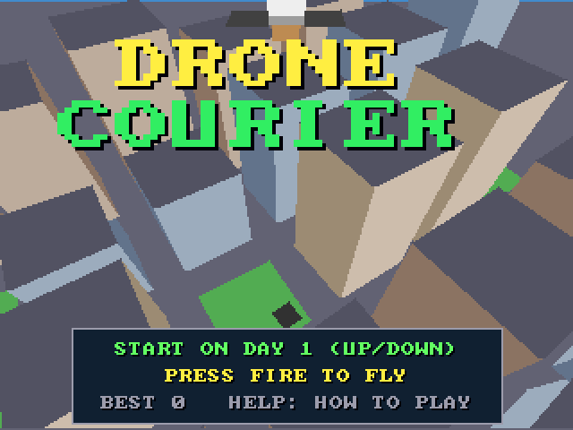
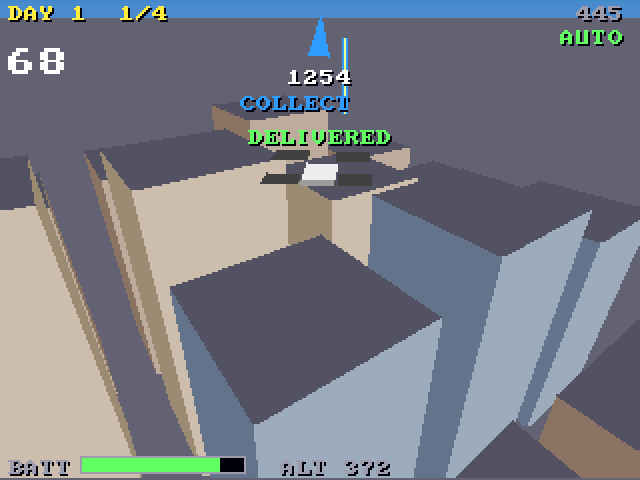

# Drone Courier (3DO)

The [amiga_mcp](https://github.com/geekychris/amiga_mcp) game
`examples/drone_courier` (classic Amiga and AmigaOS 4) on the 3DO, on the
[`amiga3d`](../../sdk/amiga3d/README.md) engine's 3DO platform layer.
Deliveries across a city of towers by drone: collect each parcel, fly it to the pad on a rooftop or the street, mind the wind, the battery and the fragile ones. Eight days; an autopilot flies on its own, and behind the title. (The city is culled by grid cell: the engine's proposed culling, in the game's own `render.c`.)

## Playing

| Pad | |
|---|---|
| D-pad up/down | forward / back; on the title, the day |
| D-pad left/right | turn |
| A | climb (let go and it sinks slowly); start |
| P | start (title), pause (play) |
| B | the autopilot on/off |
| C | the help pages |
| L | back to the title |
| X | back to the arcade menu |

## Speed

About **16-17 fps** under the emulator (the ARM60 at 12.5 MHz), with the classic Amiga's view range (560): the best of the ports, and it plays well.

## The port

The game's sources (`src/`: `courier.h`, `dc.h`, `dc_core.c`, `game.c`, `render.c`; its tests in
`src/tests/`) are the Amiga ones, changed only where Norcroft C89 or the
3DO needs it:

- `dc_state_hash`: one run-time array initialiser rewritten as assignments (`sdk/amiga3d/tools/c89init.py`)
- On-screen key names (help pages, "PRESS FIRE"): a 3DO line naming the pad's buttons under `#ifdef AMIGA3DO` (`sdk/amiga3d/tools/padtext.py`)

`src/pad_3do.c` maps the pad onto the game's keys and joystick and gives the
status line the test reads.

`./3do test drone_courier` runs the game's own tests on the 3DO (30, among them
the long autopilot game whose state hash must match `tests/vectors.h`),
then the game itself: title, a start, A climbing, the D-pad turning and flying forward, the autopilot delivering, the frame rate, X to the menu.
