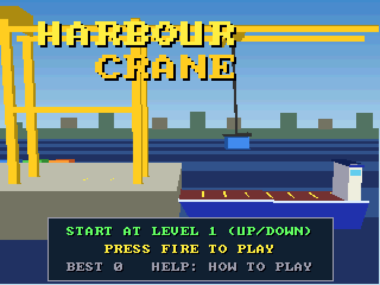
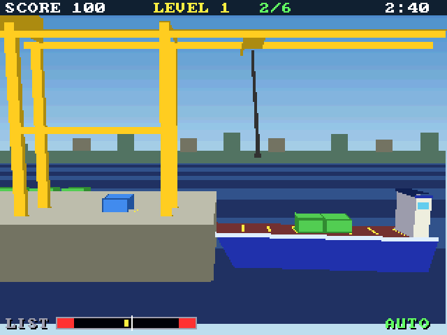

# Harbour Crane (3DO)

The [amiga_mcp](https://github.com/geekychris/amiga_mcp) game
`examples/harbour_crane` (classic Amiga and AmigaOS 4) on the 3DO, on the
[`amiga3d`](../../sdk/amiga3d/README.md) engine's 3DO platform layer.
Load a rolling ship with a gantry crane whose hook swings like a pendulum, pushed by the trolley's starts and stops and by the wind. Land each container square on the deck, keep the ship level, beat the clock: eight levels, an autopilot that also works the crane behind the title.

## Playing

| Pad | |
|---|---|
| D-pad left/right | move the trolley |
| D-pad up/down | winch in / out; on the title, the start level |
| A | grab / let go; start |
| P | start (title), pause (play) |
| B | the autopilot on/off |
| C | the help pages |
| L | back to the title |
| X | back to the arcade menu |

## Speed

About **11-13 fps** under the emulator (the ARM60 at 12.5 MHz). The pendulum and the ship keep their real speed (25 steps a second, stepped by the clock): fully playable.

## The port

The game's sources (`src/`: `crane.h`, `game.c`, `hc.h`, `hc_core.c`, `render.c`; its tests in
`src/tests/`) are the Amiga ones, changed only where Norcroft C89 or the
3DO needs it:

- `hc_state_hash`: one run-time array initialiser rewritten as assignments (`sdk/amiga3d/tools/c89init.py`)
- `game.c` (bridge variables) and `render.c` (the LIST gauge): four 64-bit products through `a3d_i64.h`
- On-screen key names (help pages, "PRESS FIRE"): a 3DO line naming the pad's buttons under `#ifdef AMIGA3DO` (`sdk/amiga3d/tools/padtext.py`)

`src/pad_3do.c` maps the pad onto the game's keys and joystick and gives the
status line the test reads.

`./3do test harbour_crane` runs the game's own tests on the 3DO (51, among them
the long autopilot game whose state hash must match `tests/vectors.h`),
then the game itself: title, a start, the D-pad running the trolley and the winch, the autopilot loading a container, the frame rate, X to the menu.
