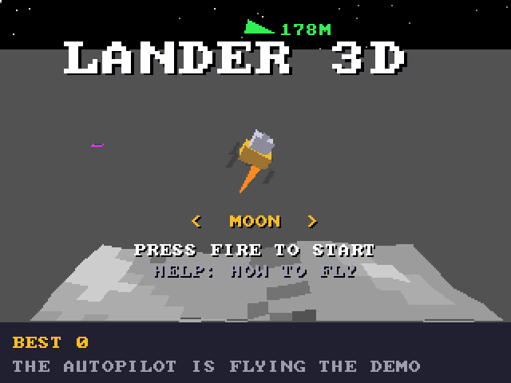

# Lander 3D (3DO)

The [amiga_mcp](https://github.com/geekychris/amiga_mcp) game
`examples/lander_3d` (classic Amiga and AmigaOS 4) on the 3DO, on the
[`amiga3d`](../../sdk/amiga3d/README.md) engine's 3DO platform layer.
Land on generated terrain - the Moon, Mars, an asteroid, or the tour of all three - with full thrust, a steady throttle, pitch and roll, on pads worth up to five times the score. The title flies a demo with the autopilot. Its own music (`takeme/lander_3d/lander_3d.mod`, "Quiet Descent", from the amiga_mcp modgen).

## Playing

| Pad | |
|---|---|
| D-pad up/down | pitch |
| D-pad left/right | roll; on the title, the world |
| A | full thrust; start |
| B / C | the steady throttle up / down |
| P | start (title), pause (play) |
| L | back to the title |
| R | the help pages |
| X | back to the arcade menu |

## Speed

About **4-5 fps** under the emulator (the ARM60 at 12.5 MHz), lower for the first seconds of a level while the background autopilot check (the "probe" flight that sizes the tank) runs - on the 3DO in 30-step slices instead of 150, so it doesn't stall. The flight keeps its real speed (100 simulation steps a second, stepped by the clock), so landings work, but at this frame rate it is a hard game: slow but fair, not smooth.

## The port

The game's sources (`src/`: `game.c`, `lander.h`, `ld.h`, `ld_core.c`, `render.c`; its tests in
`src/tests/`) are the Amiga ones, changed only where Norcroft C89 or the
3DO needs it:

- `ld_core.c` (`flatten`): a 64-bit sum of heights through `a3_i64_add` / `a3_i64_div` (`a3d_i64.h`), exact
- `game.c`: the probe flight in 30-step slices on the 3DO
- `tests/test_cases.c`: on the 3DO it also prints `tests/trace_main.c`'s flight (`TRACE` lines)
- On-screen key names (help pages, "PRESS FIRE"): a 3DO line naming the pad's buttons under `#ifdef AMIGA3DO` (`sdk/amiga3d/tools/padtext.py`)

`src/pad_3do.c` maps the pad onto the game's keys and joystick and gives the
status line the test reads.

`./3do test lander_3d` runs the game's own tests on the 3DO (49: the
physics, scoring, the autopilot landing on every world),
then the game itself: the autopilot flight of `tests/trace_main.c` built natively and compared with the 3DO's line by line (Lander 3D has no `vectors.h`; this is its host check), then the title's demo, a start, pitch, roll, thrust and the steady throttle on the pad, the frame rate, X to the menu.
