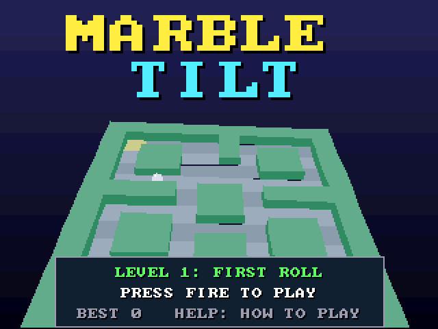

# Marble Tilt (3DO)

The [amiga_mcp](https://github.com/geekychris/amiga_mcp) game
`examples/marble_tilt` (classic Amiga and AmigaOS 4) on the 3DO, on the
[`amiga3d`](../../sdk/amiga3d/README.md) engine's 3DO platform layer.
Tilt a floating maze board to roll a marble to the exit against the clock: eight levels of holes, gates that open and shut, bumpers, sand and checkpoints. An autopilot rolls on its own, and behind the title.

## Playing

| Pad | |
|---|---|
| D-pad | tilt the board (up: the marble rolls away); on the title up/down picks the level |
| A | start |
| P | start (title), pause (play) |
| B | the autopilot on/off |
| C | the help pages |
| L | back to the title |
| X | back to the arcade menu |

## Speed

About **10-11 fps** under the emulator (the ARM60 at 12.5 MHz). The simulation keeps its real speed (25 steps a second, stepped by the clock), so the game plays at the right pace, a little jerkily.

## The port

The game's sources (`src/`: `game.c`, `mt.h`, `mt_core.c`, `render.c`, `tilt.h`; its tests in
`src/tests/`) are the Amiga ones, changed only where Norcroft C89 or the
3DO needs it:

- `mt_state_hash`: one run-time array initialiser rewritten as assignments (`sdk/amiga3d/tools/c89init.py`)
- On-screen key names (help pages, "PRESS FIRE"): a 3DO line naming the pad's buttons under `#ifdef AMIGA3DO` (`sdk/amiga3d/tools/padtext.py`)

`src/pad_3do.c` maps the pad onto the game's keys and joystick and gives the
status line the test reads.

`./3do test marble_tilt` runs the game's own tests on the 3DO (27, among them
the long autopilot game whose state hash must match `tests/vectors.h`),
then the game itself: title, a start, the D-pad tilting the board both ways, the autopilot rolling through a level, the frame rate, X to the menu.
