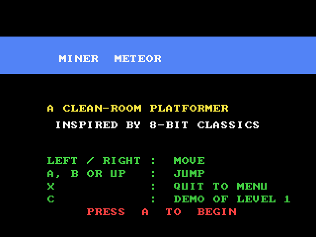
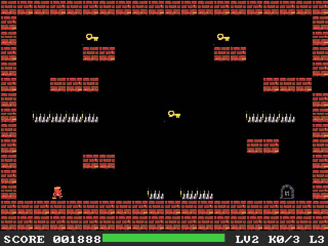

# Miner Meteor (3DO)

A 3DO port of Miner Meteor, the single-screen platformer from
[geekychris/amiga_games](https://github.com/geekychris/amiga_games)
(`miner_meteor/`, an AGA game in C++). Collect the keys to unlock the exit
before the air runs out, past spikes, conveyor belts, collapsing floors and
patrolling guardians. Six caverns.

## Playing

| Pad | |
|---|---|
| LEFT / RIGHT | walk |
| A, B or UP | jump |
| A or P | start; back to the title from the end screen |
| C (title) | a recorded run through cavern 1 that hands over to you at cavern 2 |
| X | back to the arcade menu |

Silent, as on the Amiga (its sound functions are stubs).

## How it was ported

The game is C++ on the Amiga, but simple C++ (one class with methods, references,
`bool`), so it was converted to C89 for Norcroft rather than built with armcpp:

| File | |
|---|---|
| `src/game.c`, `src/game.h` | `game.cpp`: the `MinerGame` methods as `game_*` functions over the same `GameState`; references became pointers, `bool` became `int`. The rules are unchanged except for the jump (below) |
| `src/levels.c`, `src/levels.h` | `levels.cpp`, unchanged; structs as typedefs |
| `src/tilesheet_data.c` | the baked 20x8 sheet of 16x16 tiles, unchanged |
| `src/render.c` | `render.cpp` on the sdk/amiga layer. Tiles are copied straight into the layer's 8-bit pen buffer instead of one `RectFill` per run of same-coloured pixels, and since that buffer persists between frames, each grid cell is only redrawn when its tile changes (a key taken, the exit blinking, a floor collapsing) or a sprite covered it the frame before |
| `src/main_3do.c` | `main.cpp`: the pad instead of IDCMP raw keys and the CIA fire button, `gfx_swap()` instead of `ChangeScreenBuffer` + `WaitTOF`, `gfx_steps()` so the logic keeps its 50 ticks per second |
| `src/demo.h` | the recorded run (port addition): per-tick input, so it plays the same at any frame rate |

### Fixes to the original

- **No cavern could be completed:** the jump (`JUMP_IMPULSE` -8) rises 36
  pixels, but the keys sit on platforms 64 pixels above anywhere you can
  stand. The port uses -12 (66 pixels); a breadth-first search over the
  game's tick function, compiled for the host, then reaches every key and the
  exit of caverns 1, 3, 4 and 5 (it also produced `demo.h`).
  Caverns 2 and 6 still couldn't be finished, so their level data is fixed
  too (`levels`, rows marked "bug in the original: unwinnable"), the same as
  in amiga_games: in cavern 2 one of the four floor spikes in front of the
  exit is floor (row 12 `#..P.....^.^^....E.#`); in cavern 6 a step block in
  row 11 (`#....#.............#`) leads up through a gap in the row-10
  conveyor (`#<<<<<.<<<<<<<.<<<<#`, column 6) to the ledges, a gap in the
  row-3 conveyor (`#>>>>.>>>>>>>>>>>>>#`) reaches the top key, and the
  second row-10 gap (column 14) drops you past the spikes to the exit.
  Guardians, spikes, conveyors, collapsing floors and keys are otherwise
  unchanged. A search over the real game state (moving guardians,
  collapsing floors, air, the collision snaps) finds a run through every
  one of the six caverns, checked by replaying it with the game code.
  Set `JUMP_IMPULSE` to (-8) for the original jump.
- The title and end-screen captions (pen 0 on a coloured bar) are black boxes
  on the Amiga, whose default draw mode is JAM2; the port draws text in JAM1.

## Testing

`./3do test miner_meteor`: boots, starts the recorded run from the title (C),
checks that it clears cavern 1 and cavern 2 starts, plays a little, checks the
speed (50 fps, 50 logic steps/s) and quits with X. The game logs a
`MINER state=...` line on every change of mode, level, lives or keys,
`demo: start` / `demo: done` and a `status:` line every 250 frames.
