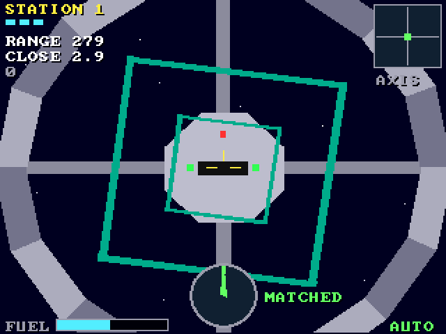

# Orbit Docking (3DO)

The [amiga_mcp](https://github.com/geekychris/amiga_mcp) game
`examples/orbit_docking` (classic Amiga and AmigaOS 4) on the 3DO, on the
[`amiga3d`](../../sdk/amiga3d/README.md) engine's 3DO platform layer.
Dock with a spinning space station: line up on its axis, match its spin with the roll, close slowly through the debris, on a fuel budget. Eight stations; an autopilot docks on its own, and behind the title. (The camera rolls with the craft: the engine's proposed `cam_roll`, in the game's own `render.c`.)

## Playing

| Pad | |
|---|---|
| D-pad | move across (the craft's left, right, up, down); on the title up/down picks the station |
| A | forward (in); start |
| C | back (out) |
| L / R | roll left / right |
| B | the autopilot on/off |
| P | start (title), pause (play) |
| X | back to the arcade menu |

## Speed

About **12-13 fps** under the emulator (the ARM60 at 12.5 MHz). The flight keeps its real speed (25 steps a second, stepped by the clock): playable. The pad has no button left for the help pages or Esc (L now rolls): X goes back to the menu.

## The port

The game's sources (`src/`: `dock.h`, `game.c`, `od.h`, `od_core.c`, `render.c`; its tests in
`src/tests/`) are the Amiga ones, changed only where Norcroft C89 or the
3DO needs it:

- `od_core.c`: the debris' phase (`(int64_t)t * 65536 / period`) through `a3_muldiv` (`a3d_i64.h`), exact; `render.c`'s fuel gauge the same way
- `od_state_hash`: one run-time array initialiser rewritten as assignments (`sdk/amiga3d/tools/c89init.py`)
- On-screen key names (help pages, "PRESS FIRE"): a 3DO line naming the pad's buttons under `#ifdef AMIGA3DO` (`sdk/amiga3d/tools/padtext.py`)

`src/pad_3do.c` maps the pad onto the game's keys and joystick and gives the
status line the test reads.

`./3do test orbit_docking` runs the game's own tests on the 3DO (33, among them
the long autopilot game whose state hash must match `tests/vectors.h`),
then the game itself: title, a start, the D-pad moving the craft across, A thrusting in, L rolling, the autopilot docking, the frame rate, X to the menu.
