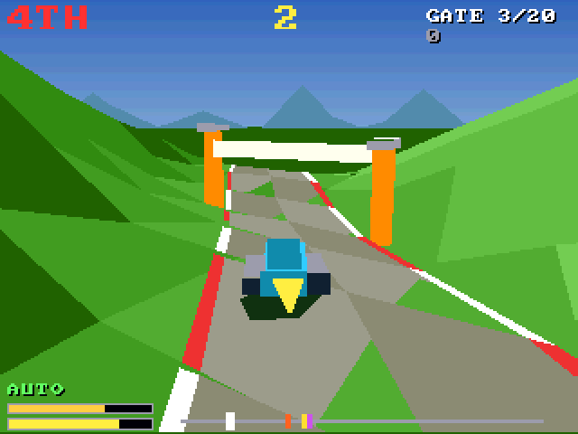

# Ridge Runner (3DO)

The [amiga_mcp](https://github.com/geekychris/amiga_mcp) game
`examples/ridge_runner` (classic Amiga and AmigaOS 4) on the 3DO, on the
[`amiga3d`](../../sdk/amiga3d/README.md) engine's 3DO platform layer.
Hover-bike racing over generated hills against three rivals: through the gates, over the jumps, boost on the straights, before the clock runs out. Eight tracks; an autopilot races on its own, and behind the title.

## Playing

| Pad | |
|---|---|
| D-pad left/right | steer |
| D-pad up / down | throttle / brake; on the title, the track |
| A | boost; start |
| P | start (title), pause (play) |
| B | the autopilot on/off |
| C | the help pages |
| L | back to the title |
| X | back to the arcade menu |

## Speed

About **7-9 fps** under the emulator (the ARM60 at 12.5 MHz), with the terrain window at the classic Amiga's 4 cells each side (`ground_win`). The race keeps its real speed (25 steps a second, stepped by the clock), so it is playable, but steering at this frame rate takes some getting used to.

## The port

The game's sources (`src/`: `game.c`, `render.c`, `rr.h`, `rr_core.c`, `runner.h`; its tests in
`src/tests/`) are the Amiga ones, changed only where Norcroft C89 or the
3DO needs it:

- `rr_state_hash`: one run-time array initialiser, and a far-ridge triangle in `render.c`, rewritten as assignments
- `rr_core.c`: its `s16()` renamed (`#define s16 rr_s16`: the 3DO's `types.h` has an `s16` type); one declaration moved above a statement (C89)
- On-screen key names (help pages, "PRESS FIRE"): a 3DO line naming the pad's buttons under `#ifdef AMIGA3DO` (`sdk/amiga3d/tools/padtext.py`)

`src/pad_3do.c` maps the pad onto the game's keys and joystick and gives the
status line the test reads.

`./3do test ridge_runner` runs the game's own tests on the 3DO (35, among them
the long autopilot game whose state hash must match `tests/vectors.h`),
then the game itself: title, a start, throttle, steering and boost on the pad, the autopilot racing through the gates, the frame rate, X to the menu.
