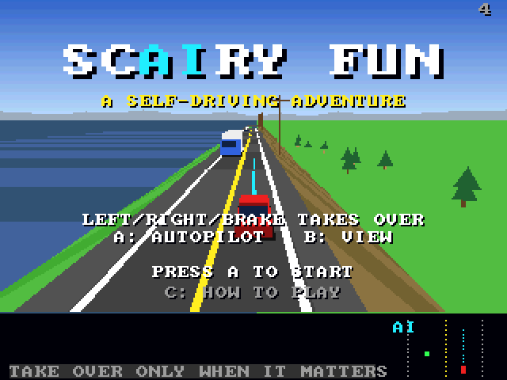
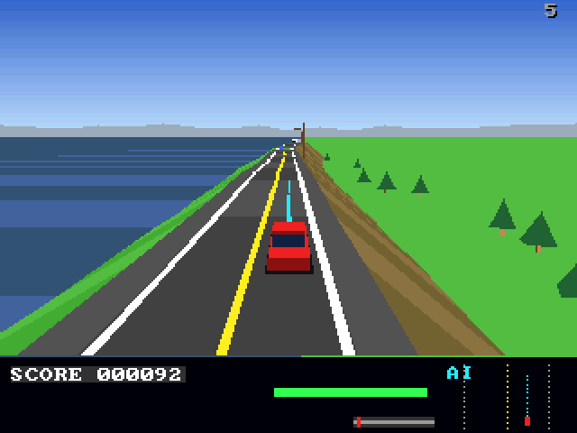

# ScAIry Fun (3DO)

The [amiga_mcp](https://github.com/geekychris/amiga_mcp) game
`examples/scairy_fun` (classic Amiga and AmigaOS 4) on the 3DO, on the
[`amiga3d`](../../sdk/amiga3d/README.md) engine's 3DO platform layer.
The self-driving car game: the car drives itself, and your job is to know when not to trust it - roadworks, low sun, an ambulance, a deer, debris, a merging truck - taking over (and handing back) at the right moments on four routes home. Its own road renderer and models on the engine's drawing, platform and sound; its music (`takeme/scairy_fun/scairy.mod`, "Autopilot Lounge") and the AI's 19 spoken lines (`scairy.voc`, Kokoro TTS), both from the amiga_mcp modgen.

## Playing

| Pad | |
|---|---|
| D-pad | steer, accelerate, brake (when you drive; steering or braking also takes over) |
| A | the autopilot on/off: take over, hand back; start |
| B | the view (chase / cockpit) |
| C | the help pages |
| P | start (title), pause (play) |
| L | back to the title |
| X | back to the arcade menu |

## Speed

About **4-5 fps** under the emulator (the ARM60 at 12.5 MHz): the road, the scenery and the traffic are about 400 polygons a frame. Its own polygon list goes to the cel engine on the 3DO (`a3_cels_begin` in its `flush`), and its projection uses the engine's reciprocal instead of four software divides, but projecting and clipping that many polygons is most of the frame. The simulation keeps its real speed (stepped by the clock), and the game is mostly about watching the autopilot and taking over in time, so it is playable, if not smooth.

## The port

The game's sources (`src/`: `game.c`, `game.h`, `models.c`, `models.h`, `render.c`, `render.h`, `sc.h`, `sound.h`, `track.c`, `world.c`; its tests in
`src/tests/`) are the Amiga ones, changed only where Norcroft C89 or the
3DO needs it:

- `world.c`: two declarations moved above a statement (C89)
- `render.c`: on the 3DO its sorted polygon list goes to the cel engine (`a3_cels_begin`/`a3_cels_poly`/`a3_cels_end`) and its projection uses `a3_recip_div`
- `tests/test_cases.c`: on the 3DO it also prints `tests/trace_main.c`'s run (`TRACE` lines)
- On-screen key names (help pages, "PRESS FIRE"): a 3DO line naming the pad's buttons under `#ifdef AMIGA3DO` (`sdk/amiga3d/tools/padtext.py`)

`src/pad_3do.c` maps the pad onto the game's keys and joystick and gives the
status line the test reads.

`./3do test scairy_fun` runs the game's own tests on the 3DO (90: the
road, the traffic, every hazard and how the autopilot meets it),
then the game itself: `tests/trace_main.c`'s run built natively and compared with the 3DO's line by line (ScAIry Fun has no `vectors.h`; this is its host check), then the title, a start, the autopilot driving, A taking over, steering and braking on the D-pad, B the view, A asking for the autopilot back, the frame rate, X to the menu.
