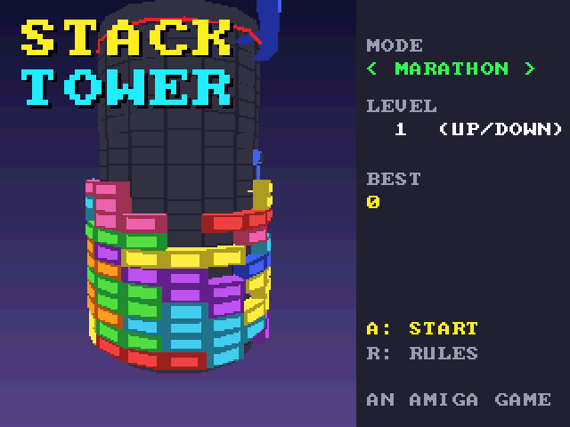

# Stack Tower (3DO)

The [amiga_mcp](https://github.com/geekychris/amiga_mcp) game
`examples/stack_tower` (classic Amiga and AmigaOS 4) on the 3DO, on the
[`amiga3d`](../../sdk/amiga3d/README.md) engine's 3DO platform layer.
A falling-block puzzle round a tower: sixteen columns that go all the way round, so moving a piece turns the tower under it, and a ring clears only when the back is full too. The browser game's eight pieces, three modes (Marathon, Rising, Dig), its own music (`takeme/stack_tower/stack_tower.mod`, "Tower Climb", from the amiga_mcp modgen). The title plays a demo.

## Playing

| Pad | |
|---|---|
| D-pad left/right | turn the tower (title: the mode) |
| D-pad up | rotate clockwise (title: the start level) |
| D-pad down | soft drop |
| A | hard drop; start |
| B | rotate anticlockwise |
| C | hold |
| P | start (title), pause (play) |
| L | the ghost piece on/off |
| R | the help pages |
| X | back to the arcade menu |

## Speed

About **5-6 fps** under the emulator (the ARM60 at 12.5 MHz): the tower is 200-250 polygons a frame, and building them (every block's corners round the cylinder) costs as much as drawing them. The game's clock keeps its real pace (gravity, the rising rubble), so it plays correctly but jerkily; hold a button for about a tenth of a second for it to register at this frame rate.

## The port

The game's sources (`src/`: `game.c`, `render.c`, `st.h`, `st_core.c`, `stack.h`; its tests in
`src/tests/`) are the Amiga ones, changed only where Norcroft C89 or the
3DO needs it:

- `st_rand_below` (`(uint64_t)rand * n >> 32`) through `a3_umul_hi`, exact; `render.c`'s face culling through `a3_dot3_nonneg` (`a3d_i64.h`)
- `st_mod`: a mask instead of two divides when `n` is a power of two (the same result; the ARM60 has no divide)
- On-screen key names (help pages, "PRESS FIRE"): a 3DO line naming the pad's buttons under `#ifdef AMIGA3DO` (`sdk/amiga3d/tools/padtext.py`)

`src/pad_3do.c` maps the pad onto the game's keys and joystick and gives the
status line the test reads.

`./3do test stack_tower` runs the game's own tests on the 3DO (45, among them
the four games played by the browser original, which must end exactly as
they did: score, board, queue, held piece, `tests/vectors.h`),
then the game itself: the title's demo, a start, the D-pad turning the tower, rotating both ways, holding, hard drops, the frame rate, X to the menu. (There is no autopilot in play: the title's demo is the one.)
