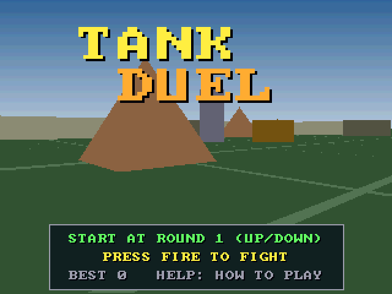
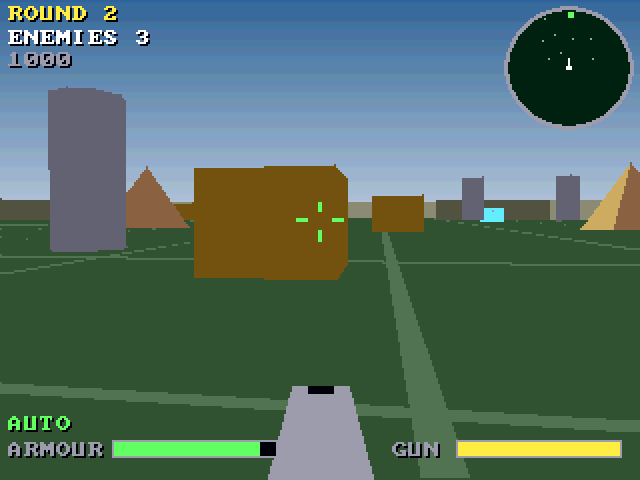

# Tank Duel (3DO)

The [amiga_mcp](https://github.com/geekychris/amiga_mcp) game
`examples/tank_duel` (classic Amiga and AmigaOS 4) on the 3DO, on the
[`amiga3d`](../../sdk/amiga3d/README.md) engine's 3DO platform layer.
A tank fight in a walled arena, seen from the turret: pillars, pyramids and crates for cover, a radar, scouts, heavies and mortar tanks over the rounds. An autopilot fights on its own, and behind the title.

## Playing

| Pad | |
|---|---|
| D-pad up/down | forward / back; on the title, the start round |
| D-pad left/right | turn |
| A | fire; start |
| P | start (title), pause (play) |
| B | the autopilot on/off |
| C | the help pages |
| L | back to the title |
| X | back to the arcade menu |

## Speed

About **13 fps** under the emulator (the ARM60 at 12.5 MHz). The fight keeps its real speed (25 steps a second, stepped by the clock): playable.

## The port

The game's sources (`src/`: `duel.h`, `game.c`, `render.c`, `td.h`, `td_core.c`; its tests in
`src/tests/`) are the Amiga ones, changed only where Norcroft C89 or the
3DO needs it:

- `td_state_hash` and one other function: run-time array initialisers rewritten as assignments (`sdk/amiga3d/tools/c89init.py`)
- On-screen key names (help pages, "PRESS FIRE"): a 3DO line naming the pad's buttons under `#ifdef AMIGA3DO` (`sdk/amiga3d/tools/padtext.py`)

`src/pad_3do.c` maps the pad onto the game's keys and joystick and gives the
status line the test reads.

`./3do test tank_duel` runs the game's own tests on the 3DO (33, among them
the long autopilot game whose state hash must match `tests/vectors.h`),
then the game itself: title, a start, the D-pad turning and driving the tank, A firing, the autopilot fighting, the frame rate, X to the menu.
