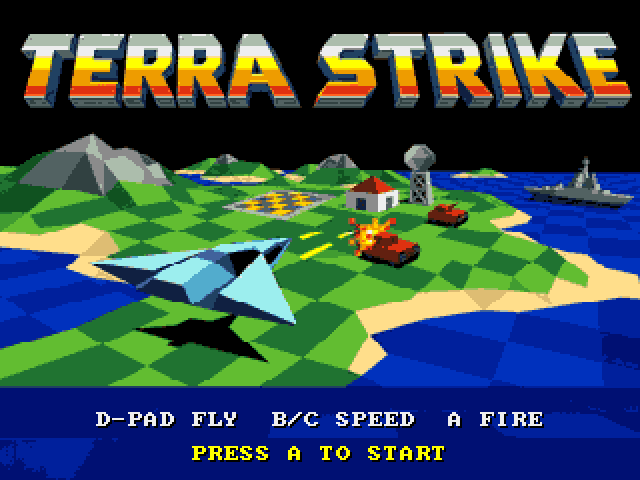
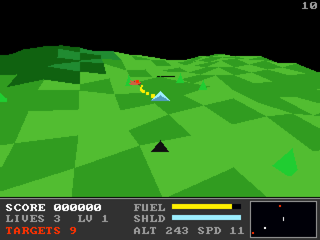

# Terra Strike (3DO)

The [amiga_mcp](https://github.com/geekychris/amiga_mcp) game
`examples/terra_strike` (classic Amiga and AmigaOS 4) on the 3DO: a Zarch /
Carrier Command style landscape shooter. Lift off from the landing pad, fly
over a wrapping fractal island, destroy the tanks, buildings and ships (the
tanks and ships shoot back), and land on the pad again to refuel and repair.
Clear every target for the next level. The title alternates between the
artwork and a 3D flyover; the music is the game's own
(`takeme/terra_strike/terra_strike.mod`, "patrol drive").

## Playing

| Pad | |
|---|---|
| D-pad | turn left / right, climb / dive (the craft hovers when you let go); UP lifts off the pad |
| A | the cannon (it aims itself at a target near the nose); start |
| B / C | throttle up / down |
| P | start (title), pause (play) |
| L | back to the title |
| X | back to the arcade menu |

## Speed

About **11-12 fps** in play under the emulator (the ARM60 at 12.5 MHz), with
170-190 polygons a frame; the title artwork at the full 25, the flyover about
9. The simulation runs at a fixed 25 Hz stepped by the clock, so the game
keeps its real speed: playable, if less smooth than the Amiga's 25 fps.

## The port

Terra Strike has its own engine (not `sdk/amiga3d`'s), but its AmigaOS 4
renderer already draws into a buffer of 8-bit pens - exactly the frame of
`sdk/amiga`'s layer - so the 3DO uses that path:

| File | |
|---|---|
| `src/ts.h`, `ts_math.c`, `terrain.c`, `world.c` | the portable core, unchanged but for `ts_math.c`'s two 64-bit clipping products, done exactly in 32-bit pieces (`a3d_i64.h`) |
| `src/render.c`, `render.h` | the AmigaOS 4 path (`#if defined(__PPC__) \|\| defined(AMIGA3DO)`); on the 3DO the font is `sdk/amiga`'s 8x8, the title artwork is copied with `memcpy`, the projection for drawing uses a reciprocal table (`ts3_div`) instead of two software divides, and `render_draw` hands the sorted polygons to the cel engine |
| `src/cels_3do.c`, `cels_3do.h` | (new) the polygons as cels - one texel of the pen's colour mapped onto each quad, as `sdk/amiga3d` does - in a layer under the frame (`gfx_set_underlay`). The frame's view area is cleared to the shadow pen, which only the 3D uses, made transparent, so the HUD and the text over the view stay on top. While the artwork shows (all 32 pens) nothing is transparent |
| `src/main_3do.c` | (new) the platform side, as `main.c` / `main_os4.c`: the display opened first (the game's `plat_ticks` needs it), the palette, the pad, the music on the layer's ptplayer, 25 fps at most; `TS_TEST=1` builds the test disc |
| `src/game.c`, `models.c`, `sound.c`, `title_image.c` | unchanged |
| `src/tests/test_cases.c` | the game's 67 unit tests, unchanged |
| `src/tests/trace.c` | (new) a scripted 4000-frame flight printed every 250 frames and at every event, for the host comparison |

On-screen key names ("PRESS FIRE", the title's key lines) have a 3DO line
naming the pad's buttons under `#ifdef AMIGA3DO` (`sdk/amiga3d/tools/padtext.py`).

`./3do test terra_strike` builds the test disc (`make TS_TEST=1
BUILD=build/selftest`) and runs the 67 unit tests on the 3DO, then the
scripted flight, which must print the same 28 lines (state, position, fuel,
the random generator, kills, a crash) as the same code built natively; then
the game: the title, a start, lift-off, throttle, turning, the cannon, the
frame rate, X to the menu.
